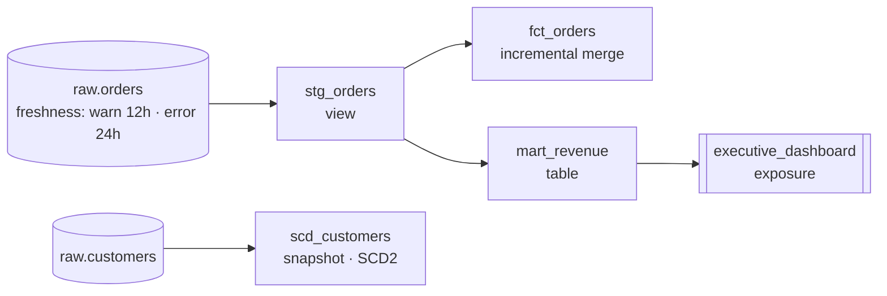

# dbt + Snowflake Warehouse

**A compact dbt project for Snowflake that shows the core analytics-engineering patterns in one place: declared sources with freshness checks, staging views, a reusable macro, an incremental fact table that handles late-arriving rows, an SCD Type 2 snapshot, schema and singular tests, and an exposure tying a KPI mart to the dashboard that uses it.**

Hand-written warehouse SQL tends to break silently: a feed stalls, a late row is skipped forever, a unit conversion is copy-pasted wrong. Each file here addresses one of those failure modes with the dbt feature designed for it.

## Lineage



## What each piece demonstrates

| File | Pattern |
|---|---|
| `models/staging/sources.yml` | Raw `orders`, `customers`, `products` declared as sources; `orders` warns after 12 hours and errors after 24 hours without new data |
| `models/staging/stg_orders.sql` | Staging view: cents to dollars via macro, lowercased status, timestamp to date, null amounts dropped |
| `macros/cents_to_dollars.sql` | One definition of the rounding rule, expanded at compile time |
| `models/marts/fct_orders.sql` | Incremental `merge` on `order_id` with a **3-day lookback**, so late-arriving orders are picked up and reprocessed rows update instead of duplicating |
| `models/marts/mart_revenue.sql` | Paid revenue and order counts by region, materialized as a table |
| `snapshots/scd_customers.sql` | SCD Type 2 snapshot (`check` strategy on `tier` and `region`) for point-in-time customer attributes |
| `models/marts/*.yml` | `not_null`, `unique`, and `accepted_values` tests; an exposure for the executive dashboard |
| `tests/no_negative_revenue.sql` | Singular test that fails if any region's revenue is negative |
| `dbt_project.yml` | Staging as views, marts as tables by default |

[WAREHOUSE.md](WAREHOUSE.md) covers the Snowflake side: separating compute from storage, how incremental runs and `--full-refresh` behave, why a strict `> MAX(date)` filter drops late rows, and warehouse sizing and auto-suspend.

## Running

Requires `dbt-core` with `dbt-snowflake` and a `snowflake` profile in `~/.dbt/profiles.yml` pointing at a database with the `ENTERPRISE.RAW` tables.

```bash
git clone https://github.com/AliAzamat/dbt-snowflake-warehouse.git
cd dbt-snowflake-warehouse
pip install dbt-snowflake

dbt source freshness
dbt build            # models, snapshot, and tests in dependency order
```

## Status

Parsing the project with dbt 1.12 surfaced issues that need fixing before `dbt build` succeeds:

- **Two compile errors from Jinja inside SQL comments.** dbt renders Jinja even in `--` comments, so the `{{ source(...) }}` mention on line 2 of `stg_orders.sql` and the trailing comment inside the `config(...)` block of `scd_customers.sql` both fail to compile. Wrapping them in `{# … #}` fixes both; with that change the project parses and lists 4 models/snapshots, 3 sources, 5 tests, and the exposure.
- **`dim_customers` has tests and docs but no model**, so dbt warns that its three tests reference a missing node.
- **`mart_revenue` selects `region`, which `stg_orders` doesn't have.** It needs a join to customers (or a region column in staging).
- `fct_orders` isn't consumed by any downstream model yet; there's no seed data.
